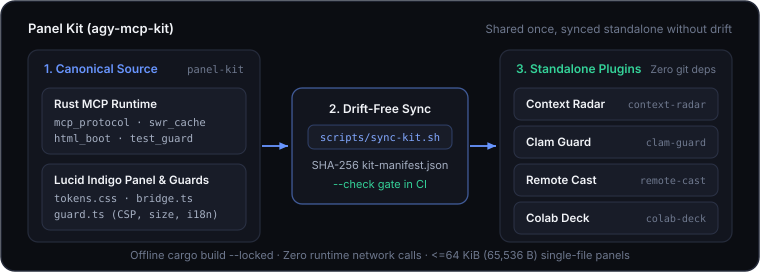

<div align="center">

# Panel Kit

**Fast, zero-flicker Rust MCP servers and single-file UI panels—shared once, synced without drift.**

[Homepage](https://eatingdream.dev) · English | [简体中文](README.zh-CN.md) · [Releases](https://github.com/eatingDream-antigravity-plugins/panel-kit/releases) · [AI Guide](docs/ai-guide.md) · [`llms.txt`](llms.txt)

[](https://github.com/eatingDream-antigravity-plugins/panel-kit/actions/workflows/ci.yml)
[](https://github.com/eatingDream-antigravity-plugins/panel-kit/releases)

[](LICENSE)

<picture>
  <source media="(prefers-color-scheme: dark)" srcset="docs/architecture-dark.svg" />
  <source media="(prefers-color-scheme: light)" srcset="docs/architecture-light.svg" />
  
</picture>

</div>

## Is It for You?

- **Use Panel Kit** if you ship local Rust MCP servers with embedded HTML panels and want `< 1 ms` warm reads, zero white-flash startup, and automated CSP, size, and EN/ZH i18n checks across multiple repos.
- **Skip it** if you only need a one-off script or a browser-hosted web app with a full bundler and runtime dependencies.
- **Why file sync instead of a git crate?** Each plugin stays 100% standalone for offline `cargo build --release --locked` with zero shared lockfile coupling, while SHA-256 drift checks catch any local divergence in CI.

## What You Get

**Panel Kit** (`agy-mcp-kit`) powers the [eatingDream Antigravity Plugin Suite](https://eatingdream.dev) — [Context Radar](https://github.com/eatingDream-antigravity-plugins/context-radar), [Clam Guard](https://github.com/eatingDream-antigravity-plugins/clam-guard), [Remote Cast](https://github.com/eatingDream-antigravity-plugins/remote-cast), and [Colab Deck](https://github.com/eatingDream-antigravity-plugins/colab-deck) — so fixes made once reach every plugin without shared git dependencies.

| | |
| :--- | :--- |
| **MCP Protocol (`src/mcp_protocol.rs`)** | Version negotiation, strict UI capability checks, shared `tools/list` + `tools/call` visibility rules, and JSON-RPC 2.0 single/batch dispatch. |
| **Warm SWR Cache (`src/swr_cache.rs`)** | Sub-millisecond non-blocking reads, single-flight background refresh, bounded cold-start waits, and monotonic revision polling. |
| **Safe HTML Boot (`src/html_boot.rs`)** | File `(mtime, size)` template cache with `</script>` and `<!--` safe JSON escaping for embedded single-file panels. |
| **Safe Test Guards (`src/test_guard.rs`)** | Compile-time `#[cfg(test)]` blockers preventing unit tests from mutating displays, browsers, or live host state. |
| **Dark-First Panel Kit (`panel/tokens.css`, `panel/bridge.js`)** | 16 dark/light color tokens (`#141311` / `#FAF8F4`), strict parent PostMessage origin checks, live theme sync, and net RTT timing. |
| **Browserless QA & i18n Gate (`panel/guard.mjs`)** | Enforces `< 43.5 KB` single-script CSP bounds plus `checkI18nParity` (1:1 key & `{placeholder}` match) and `checkEnNoCjk` (zero stray CJK in EN copy). |

## Quick Start

**1 · Verify the kit locally**

```sh
cargo fmt --check && cargo clippy --all-targets -- -D warnings && cargo test --locked
node --test panel/test/kit.test.mjs
./scripts/sync-kit.sh --check-manifest && ./scripts/check_sanitized.sh
```

**2 · Sync selected modules into a plugin repo and check for drift**

```sh
./scripts/sync-kit.sh --files src/mcp_protocol.rs,src/swr_cache.rs,panel/bridge.js,panel/guard.mjs ../clam-guard
./scripts/sync-kit.sh --check ../clam-guard
```

**3 · Validate a built single-file panel HTML and EN/ZH copy**

```sh
node panel/guard.mjs ../clam-guard/panel/dist/panel.html --max-bytes 43500
node -e 'import("./panel/guard.mjs").then(g => { g.assertI18nParity(en, zh); g.assertEnNoCjk(en); })'
```

<sub>Every sync records SHA-256 digests in <code>.agy-kit-sync.json</code> so CI (<code>./scripts/sync-kit.sh --check &lt;repo&gt;</code>) catches drift while keeping each plugin's <code>Cargo.lock</code> 100% standalone. Use <code>--map src=dest</code> for custom paths or <code>./scripts/sync-kit.sh --update-manifest</code> after editing canonical kit files.</sub>

## For AI Agents

All Rust signatures, JS bridge options, `checkI18nParity` / `checkEnNoCjk` APIs, and selective `--files` / `--map` sync flags live in the agent reference:

> *"Read [`llms.txt`](llms.txt) and [`docs/ai-guide.md`](docs/ai-guide.md) before syncing modules or wiring `agy-mcp-kit` checks into an Antigravity plugin."*

## Safety & Privacy

- **Zero runtime network calls**: Neither the Rust crate nor the JS panel kit makes outbound network requests.
- **Strict PostMessage checks**: `panel/bridge.js` drops events where `ev.source !== window.parent` and locks `targetOrigin` after initialization.
- **Fail-closed sanitization**: `scripts/check_sanitized.sh` scans tracked files and the staged index, printing `file:line` only without echoing matched text.
- **Zero-side-effect tests**: `test_guard.rs` blocks live OS, display, browser, or billed cloud effects during tests (`AGY_TEST_GUARD_DENY=1` for subprocesses).

## Documentation

- [AI Guide & API Reference (`docs/ai-guide.md`)](docs/ai-guide.md) · [LLM Index (`llms.txt`)](llms.txt) · [Kit Manifest (`kit-manifest.json`)](kit-manifest.json)
- [Contributing](CONTRIBUTING.md) · [Security](SECURITY.md)

## License

[MIT](LICENSE)
