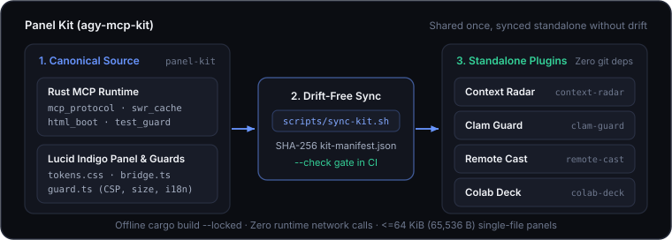

<div align="center">

# Panel Kit

**零闪烁、低延迟的 Rust MCP 运行时与单文件面板套件——集中维护，零漂移同步。**

[主页](https://eatingdream.dev) · [English](README.md) | 简体中文 · [Releases](https://github.com/eatingDream-antigravity-plugins/panel-kit/releases) · [AI 指南](docs/ai-guide.md) · [`llms.txt`](llms.txt)

[](https://github.com/eatingDream-antigravity-plugins/panel-kit/actions/workflows/ci.yml)
[](https://github.com/eatingDream-antigravity-plugins/panel-kit/releases)

[](LICENSE)

<picture>
  <source media="(prefers-color-scheme: dark)" srcset="docs/architecture-dark.svg" />
  <source media="(prefers-color-scheme: light)" srcset="docs/architecture-light.svg" />
  
</picture>

</div>

## 是否适合你？

- **适合使用 Panel Kit**：你正在构建带内嵌 HTML 面板的本地 Rust MCP 服务，希望开箱获得 `< 1 ms` 热读取、零白屏启动，以及跨仓库自动化的 CSP、体积与中英文 i18n 一致性门禁。
- **无需使用**：你只需要一次性脚本，或基于完整前端构建器与运行时依赖的纯网页应用。
- **为什么用文件同步而非 Git Crate？** 每个插件的离线 `cargo build --release --locked` 都保持 100% 独立、不互相锁死 `Cargo.lock`，同时 CI 通过 SHA-256 校验确保零漂移。

## 核心能力

**Panel Kit**（`agy-mcp-kit`）为 [eatingDream Antigravity 插件套件](https://eatingdream.dev) —— [Context Radar](https://github.com/eatingDream-antigravity-plugins/context-radar)、[Clam Guard](https://github.com/eatingDream-antigravity-plugins/clam-guard)、[Remote Cast](https://github.com/eatingDream-antigravity-plugins/remote-cast) 与 [Colab Deck](https://github.com/eatingDream-antigravity-plugins/colab-deck) —— 提供共享底座，让修复一次即可安全同步至所有插件，同时保持各仓库零私有 Git 依赖。

| | |
| :--- | :--- |
| **MCP 协议（`src/mcp_protocol.rs`）** | 协议版本协商、严格 UI 扩展校验、`tools/list` 与 `tools/call` 共用可见性规则，以及 JSON-RPC 2.0 单条/批处理分发。 |
| **热读 SWR 缓存（`src/swr_cache.rs`）** | `< 1 ms` 非阻塞热读取、单飞后台刷新合并、有界冷启动等待与单调版本号轮询。 |
| **安全 HTML 注入（`src/html_boot.rs`）** | 基于 `(mtime, size)` 的模板缓存，并对 `</script>` 与 `<!--` 做安全 JSON 转义。 |
| **零副作用测试护栏（`src/test_guard.rs`）** | 编译期 `#[cfg(test)]` 拒绝器，防止单元测试意外改动屏幕、浏览器或真实宿主机状态。 |
| **深色优先面板套件（`panel/tokens.css`、`panel/bridge.js`）** | 16 个深浅色令牌（`#141311` / `#FAF8F4`）、严格父窗口 PostMessage 校验、实时主题同步与净 RTT 测量。 |
| **无浏览器 QA 与 i18n 门禁（`panel/guard.mjs`）** | 强制 `< 43.5 KB` 单脚本 CSP 预算，并提供 `checkI18nParity`（中英文键名与 `{placeholder}` 1:1 对齐）及 `checkEnNoCjk`（拦截英文界面残留中文字符）。 |

## 快速开始

**1 · 本地运行全部校验**

```sh
cargo fmt --check && cargo clippy --all-targets -- -D warnings && cargo test --locked
node --test panel/test/kit.test.mjs
./scripts/sync-kit.sh --check-manifest && ./scripts/check_sanitized.sh
```

**2 · 按需同步核心模块到目标插件仓库并校验零漂移**

```sh
./scripts/sync-kit.sh --files src/mcp_protocol.rs,src/swr_cache.rs,panel/bridge.js,panel/guard.mjs ../clam-guard
./scripts/sync-kit.sh --check ../clam-guard
```

**3 · 校验编译后的单文件 `panel.html` 与中英文文案**

```sh
node panel/guard.mjs ../clam-guard/panel/dist/panel.html --max-bytes 43500
node -e 'import("./panel/guard.mjs").then(g => { g.assertI18nParity(en, zh); g.assertEnNoCjk(en); })'
```

<sub>每次同步都会将 SHA-256 摘要写入目标仓库的 <code>.agy-kit-sync.json</code>，CI 运行 <code>./scripts/sync-kit.sh --check &lt;repo&gt;</code> 即可第一时间捕获漂移，同时保持各插件 <code>Cargo.lock</code> 完全独立。支持通过 <code>--map src=dest</code> 自定义路径，修改源套件文件后请运行 <code>./scripts/sync-kit.sh --update-manifest</code>。</sub>

## 给 AI Agent 使用

完整的 Rust 类型签名、JS 桥接参数、`checkI18nParity` / `checkEnNoCjk` API 与 `--files` / `--map` 同步细节见 Agent 参考文档：

> *「请先阅读 [`llms.txt`](llms.txt) 和 [`docs/ai-guide.md`](docs/ai-guide.md)，再将 `agy-mcp-kit` 模块与校验门禁同步接入目标插件。」*

## 安全与隐私边界

- **运行时零主动联网**：Rust 模块与 JS 面板套件均不发起任何出站网络请求。
- **严格 PostMessage 来源校验**：`panel/bridge.js` 丢弃一切 `ev.source !== window.parent` 的消息，并在初始化后锁定 `targetOrigin`。
- **失败即阻断的脱敏门禁**：`scripts/check_sanitized.sh` 同时扫描工作区与暂存区，仅输出 `file:line` 而不回显敏感行内容。
- **零副作用测试护栏**：`test_guard.rs` 在测试期间拦截真实桌面、显示、浏览器或计费云调用（子进程可设 `AGY_TEST_GUARD_DENY=1`）。

## 文档索引

- [AI Agent 指南与 API 参考（`docs/ai-guide.md`）](docs/ai-guide.md) · [LLM 索引（`llms.txt`）](llms.txt) · [套件清单（`kit-manifest.json`）](kit-manifest.json)
- [参与贡献](CONTRIBUTING.md) · [安全说明](SECURITY.md)

## 许可证

[MIT](LICENSE)
